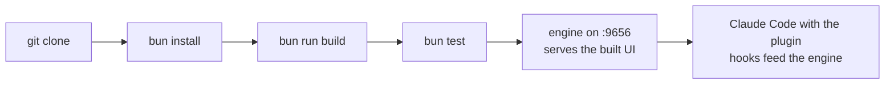

# Contributing to yolo-twice

This guide takes you from a fresh clone to a running engine, UI and plugin, and shows the
inner loop for each part of the code. Design background lives in
[documentation/design.md](documentation/design.md); the HTTP, SSE and CLI contract lives in
[code/API.md](code/API.md).

## Prerequisites

| Tool | Version | Why |
|---|---|---|
| [bun](https://bun.sh) | 1.2 or newer | workspaces, tests, dev scripts |
| Node.js | 20 or newer, 22 recommended | the built engine runs on plain Node; Vite and Slidev want 20.19+ or 22 |
| Claude Code | 2.1.275 or newer | to run the plugin and the headless summarizer |
| curl | any | the plugin's hook script |

## From source to running



```sh
git clone git@github.com:bar9/yolo-twice.git
cd yolo-twice/code
bun install          # all workspaces, about 2 s
bun run build        # core, analyzers, engine, pele-markdown, then the UI, about 10 s
bun test             # 22 tests, about 2 s
bun run typecheck
```

Start the engine for this repository and open the UI:

```sh
bun run cli open --cwd ..      # starts the daemon if needed, prints and opens the URL
bun run cli status --cwd ..
bun run cli stop
```

The repository ships its own `.yolo-twice/` folder, so even on a machine that never ran a
session here the UI shows the committed history. To continue that session in Claude Code:

```sh
bun run cli resume --cwd ..    # rebuilds the transcript under ~/.claude and runs claude --resume
```

## Running the plugin from your checkout

Two options, pick one.

**Per session, nothing installed.** Claude Code loads the plugin straight from the folder:

```sh
cd /path/to/yolo-twice
claude --plugin-dir code/plugin
```

**Installed, the way users get it.** Register your checkout as a local marketplace once.
Edits to the plugin files take effect in new sessions:

```sh
claude plugin marketplace add /path/to/yolo-twice
claude plugin install yolo@yolo-twice
```

Inside Claude Code the command is `/yolo:twice`, with `stop`, `status`,
`mode <micro|attentive|balanced|yolo>` and `resume [id]`. The plugin's launcher finds the engine in your checkout,
so it runs your local code. It prefers `code/packages/engine/dist/cli.js` when present, so
run `bun run build` after changing engine code, or delete `dist/` to fall back to running
the TypeScript source with bun.

Hooks post to `127.0.0.1:9656`. When the engine is down they fail silently, so a session
without the engine is never disturbed.

To remove the dev install:

```sh
claude plugin uninstall yolo@yolo-twice
claude plugin marketplace remove yolo-twice
```

## Where the code lives

| Path | What | Inner loop |
|---|---|---|
| `code/packages/core` | event schema, Claude Code reader, redaction, cursor, `.yolo-twice` store | `bun test packages/core` |
| `code/packages/analyzers` | structure tree, mermaid graph, search, semantic cache and summarizers | `bun test packages/analyzers` |
| `code/packages/engine` | daemon, HTTP and SSE API, CLI, resume (npm package `yolo-twice`) | `bun run engine` |
| `code/packages/ui` | Vite and React web UI | `bun run mock` plus `bun run dev:ui` |
| `code/packages/pele-markdown` | markdown-it plugin rendering mermaid with pele | `bun test packages/pele-markdown` |
| `code/plugin` | Claude Code plugin: command, hooks, launcher scripts | `claude --plugin-dir code/plugin` |
| `code/site` | VitePress website | `bun run --filter @yolo-twice/site dev` |
| `code/pitch` | Slidev pitch deck | `bun run --filter @yolo-twice/pitch dev` |
| `code/fixtures` | synthetic Claude Code project used by every test and the UI mock | |

All commands in the table run from `code/`.

## Inner loops

### Core and analyzers

Test-driven against the fixture. `fixtures/helper.ts` copies the synthetic Claude Code
project into a temp directory per test, so tests never touch `~/.claude`.

```sh
bun test --watch packages/core packages/analyzers
```

To see what your change does to real sessions without touching the repo's committed index,
index into a scratch project and point it at a real Claude Code session folder:

```sh
mkdir -p /tmp/yt && git -C /tmp/yt init -q
YOLO_TWICE_ORIGIN_DIR=~/.claude/projects/<slug-of-any-project> bun run cli index --cwd /tmp/yt
```

The slug is the project path with every non-alphanumeric character replaced by `-`, for
example `-home-you-git-yolo-twice`. `index` writes into the git root of `--cwd`. It is
idempotent: a second run appends nothing and rewrites identical bytes.

### Engine

Run it in the foreground from source so logs go to your terminal:

```sh
bun run engine -- --cwd ..
```

Useful environment variables:

| Variable | Effect |
|---|---|
| `YOLO_TWICE_PORT` | port instead of 9656, so a dev engine can run next to an installed one |
| `YOLO_TWICE_HOME` | runtime state folder instead of `~/.yolo-twice` |
| `YOLO_TWICE_NO_LLM=1` | never call `claude -p`; summaries come from the structural fallback |
| `YOLO_TWICE_ORIGIN_DIR` | `index` reads sessions from this folder instead of `~/.claude/projects/<slug>` |
| `YOLO_TWICE_ENGINE` | the plugin launcher runs this engine (a `cli.js`, a `cli.ts` or a command) |
| `CLAUDE_CONFIG_DIR` | where Claude Code's data lives, if not `~/.claude` |

A fully isolated dev engine that cannot collide with anything installed:

```sh
YOLO_TWICE_HOME=/tmp/yt-home YOLO_TWICE_PORT=9661 YOLO_TWICE_NO_LLM=1 bun run engine -- --cwd ..
```

Engine tests start the server in-process on a random port: `bun test packages/engine`.

### Engine and UI together, with auto reload

```sh
bun run dev
```

This stops any running engine, then runs two watchers side by side: the engine from source
under `bun --watch` (restarts on every saved engine, core or analyzers file) and
`vite build --watch` (rewrites `packages/ui/dist` on every saved UI file). Open the URL
the engine prints. The page reloads by itself after either one: on connect the stream's
`hello` carries a build id of the engine run and the UI bundle, and the engine sends a
`build` event when `dist` changes. Your place in the session survives the reload because it
lives in the URL. Combine with `YOLO_TWICE_PORT` and `YOLO_TWICE_HOME` to keep it away from an
installed engine.

The same check runs in the installed engine, so after `bun run build` and
`bun run cli stop` / `open`, open tabs pick up the new version without a manual reload.

### UI

The UI talks only to the API in `code/API.md`, so it can be developed without the engine.
The mock serves the fixture on port 9656:

```sh
bun run mock        # terminal 1: fake engine on 127.0.0.1:9656
bun run dev:ui      # terminal 2: Vite on http://localhost:5173 with hot reload
```

Vite proxies `/api`, `/hook` and `/health` to port 9656, so the same dev server works
against the real engine: stop the mock, run `bun run engine -- --cwd ..` instead.

The engine serves `packages/ui/dist` at `/`. After UI changes, `bun run build` makes them
visible through the engine and the plugin.

### Website and pitch deck

```sh
bun run --filter @yolo-twice/site dev      # VitePress with hot reload
bun run --filter @yolo-twice/pitch dev     # Slidev, opens the browser
bun run build:site
bun run build:pitch
```

Diagrams are mermaid everywhere and rendered with [pele](https://pele.run/). In the site a
build-time plugin turns mermaid fences into SVG; in the deck the `Pele` component renders on
the client. Every push to `main` deploys both to https://bar9.github.io/yolo-twice/ through
`.github/workflows/pages.yml`.

## Conventions

- **The API contract is shared.** Changing an endpoint or SSE event means editing
  `code/API.md` in the same commit, because the UI and the mock code against it.
- **Types live in `packages/core/src/schema.ts`.** The UI imports them with `import type`
  only, so no Node code reaches the browser bundle.
- **Idempotency is tested.** Anything written to `.yolo-twice/` must be deterministic:
  sorted keys, atomic writes, ids from the source record. Add a "run twice, same bytes" test
  for new artifacts.
- **Redaction before write.** Nothing reaches `.yolo-twice/` without passing
  `redact()`. If you add a field that carries user text, route it through the same path and
  extend the redaction test.
- **The fixture is synthetic.** Never commit a real transcript as a fixture. Extend
  `fixtures/raw/` by hand when a test needs a new record shape.
- **Commit small and often.** Each commit should leave `bun test` and `bun run typecheck`
  green.

## Troubleshooting

| Symptom | Cause and fix |
|---|---|
| `Vite requires Node.js version 20.19+` | a warning on older Node 20; the build still succeeds. Upgrade to Node 22 to silence it |
| Slidev fails under Node with a `styleText` error | Slidev 53 needs Node 22; the deck scripts already run it through bun |
| `/yolo:twice` runs old engine code | the launcher prefers `dist/`; run `bun run build`, then restart the engine (`bun run cli stop`) |
| A new UI feature is missing although the UI was rebuilt | the engine still runs the old API; restart it, or use `bun run dev` |
| Port 9656 in use | another engine is running: `bun run cli status`, `bun run cli stop`, or use `YOLO_TWICE_PORT` |
| UI shows "not built" | run `bun run build`, the engine serves `packages/ui/dist` |
| Summaries look like truncated text | the structural fallback answered: `claude` is not on `PATH`, `YOLO_TWICE_NO_LLM` is set, or the CLI failed (see `~/.yolo-twice/engine.log`) |
| No sessions in the UI | Claude Code stores sessions under the exact working directory it was started in; start `claude` in the project root, or check `bun run cli status --cwd <dir>` |
