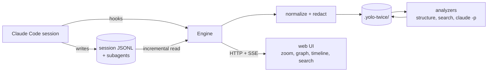
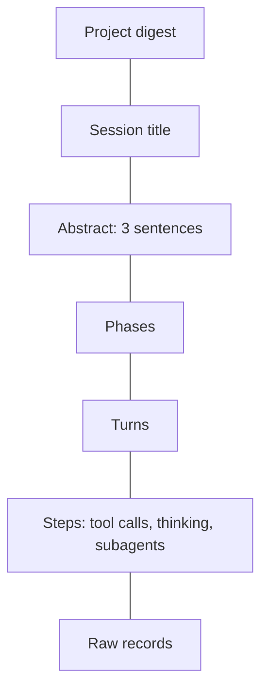

# yolo-twice

Website: [bar9.github.io/yolo-twice](https://bar9.github.io/yolo-twice/) · Pitch deck: [/pitch](https://bar9.github.io/yolo-twice/pitch/)

**Transparent agentic development superpowers.** See what your coding agent did, at the
zoom level you choose, while it is still running.

## The problem

A long Claude Code session leaves behind megabytes of JSONL: hundreds of turns, tool calls,
subagent transcripts, rewinds and compactions. Reading it as a chat list does not scale, and
the existing viewers, good as they are, show exactly that list. You either micro-manage every
tool call or you go full yolo and lose track of what happened.

## What yolo-twice does

- **Semantic zoom.** Read a session as one line, three sentences, a paragraph of phases, the
  turns, or the raw records. Any text, including the top summary and a long tool result, can be
  zoomed out one more step or expanded in place.
- **Live flow graph.** The conversation as a graph: turns, tool calls, subagents and rewind
  branches, updated while the session runs, merging into phases as you zoom out.
- **Attention slider.** From "micro management" (every turn summarized live) to "yolo"
  (nothing until you ask, then "catch me up"). You choose how many tokens and how much
  attention to spend; the cost is shown next to the slider.
- **Project-local history.** Everything derived lands in `.yolo-twice/` in your repo,
  redacted, plain JSON and mermaid, so you can commit it or gitignore it.
- **Incremental and idempotent.** Stop the engine, resume later, run it twice: same bytes.

## Install

One command, in a terminal where Claude Code is installed (version 2.1.275 or newer, Node 22
or newer):

```
claude plugin install yolo-twice --marketplace bar9/yolo-twice
```

## Use

Inside any Claude Code session (plugin commands are namespaced, so the command is `/yolo-twice:yolo-twice`):

```
/yolo-twice:yolo-twice                  start the engine for this project and open the UI
/yolo-twice:yolo-twice stop             stop the engine
/yolo-twice:yolo-twice status           show engine, session and index state
/yolo-twice:yolo-twice mode yolo        set the attention slider: micro | attentive | balanced | yolo
```

The same commands work from a terminal via the engine CLI, for example `yolo-twice status` or
`yolo-twice index` for a one-shot index without the daemon.

## How it works



Claude Code hooks tell the engine that something happened. The engine reads the new lines of
the session transcript from its cursor, normalizes them into one event per line, redacts
secrets, and appends them to `.yolo-twice/`. Structural levels (session, phases, turns, steps)
are derived without any model call. Summaries and labels are produced by the Claude Code CLI
itself in headless mode, cached by content hash, and only as eagerly as the attention slider
allows. The UI is updated over Server-Sent Events.



## What lands in your repo

```
.yolo-twice/
  config.json                  attention level, redaction rules, enabled analyzers
  project.json                 session list and project digest
  sessions/<id>/
    events.ndjson              redacted, normalized events
    structure.json             the zoom tree
    graph.mmd                  the flow graph as mermaid
    text/                      titles, abstracts and summaries per node
  cache/, engine.json          gitignored
```

Raw transcripts stay in `~/.claude`. Only redacted events and derived data are written here.

## Acknowledgments

yolo-twice did not invent transcript viewing. These projects came first, and we learned from
each of them. If one of them fits your need better, use it.

| Project                                                                                            | What it does well                                                             | Where yolo-twice differs                                    |
| -------------------------------------------------------------------------------------------------- | ----------------------------------------------------------------------------- | ----------------------------------------------------------- |
| [Claudescope](https://github.com/vladar107/claudescope) by vladar107                               | Browses eight agents, full-text search, cost analytics, MCP server and plugin | Abstraction levels, flow graph, committed project history   |
| [claude-code-history-viewer](https://github.com/jhlee0409/claude-code-history-viewer) by jhlee0409 | Desktop app for over thirty agents, live updates, session board               | One running session, deeply zoomable, instead of breadth    |
| [cc_transcript_viewer](https://github.com/tim-hua-01/cc_transcript_viewer) by tim-hua-01           | Zero dependencies, live tail, five agents                                     | We borrowed the live-tail idea and add semantics on top     |
| [claude-code-transcripts](https://github.com/simonw/claude-code-transcripts) by simonw             | Publishing paginated HTML transcripts, Gist upload                            | Live navigation rather than publishing                      |
| [ccusage](https://github.com/ryoppippi/ccusage) by ryoppippi                                       | Token and cost reporting across agents                                        | Cost shown per phase in context; use ccusage for accounting |
| [pele](https://github.com/obsidianmd/pele) by the Obsidian team                                    | Fast, themeable mermaid rendering                                             | We use it as-is for every diagram, with thanks              |

Mermaid is the only diagram format we use, on GitHub, on the website, in the pitch deck and in
the UI, so the same text renders everywhere.

## License

MIT, see [license.txt](license.txt).
