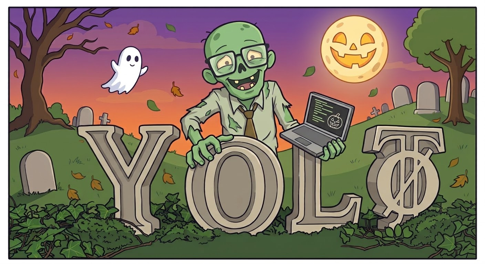

<div class="cover-band">
  <h1>yolo-twice</h1>
  <p class="cover-tag">What did the agent do, and why?</p>
  <p class="cover-team">BaselHack 2026 · Matthias Cullmann · Roland Brand · Jan Babin · Thomas Schöller</p>
</div>

<!--
0:00–0:10. Hi, we are yolo-twice. We want to talk about a question every team using coding agents runs into: what did the agent actually do, and why?
-->

---
layout: center
class: text-center
---

<div class="story">

It's Friday afternoon. The agent has been working for three hours.

<v-click>

The pull request is **+2,400 lines**.

</v-click>

<v-click>

The reviewer asks: *"Why did it switch to RS256? Did anyone ask it to drop rate limiting?"*

</v-click>

<v-click>

Nobody really knows.

</v-click>

</div>

<!--
0:10–0:35. Tell it as a scene. Three hours of agent work, a big PR, a reasonable review question. The developer was there, sort of. They approved things, went for coffee, came back. The answer is somewhere in the session, and nobody can find it.
-->

---

# The answer is in there, somewhere

<div class="wall">
{"parentUuid":"a2","isSidechain":false,"type":"user","message":{"role":"user","content":[{"tool_use_id":"toolu_01","type":"tool_result","content":"auth.ts\nusers.ts\n"}]},"uuid":"u2","timestamp":"2026-10-31T08:00:07.000Z"} {"parentUuid":"u2","type":"assistant","message":{"role":"assistant","model":"claude-fable-5-1","content":[{"type":"tool_use","id":"toolu_r1","name":"Read","input":{"file_path":"/tmp/yolo-demo/src/routes/auth.ts"}}]},"uuid":"a3"} {"parentUuid":"a3","type":"user","message":{"role":"user","content":[{"tool_use_id":"toolu_r1","type":"tool_result","content":"const API_KEY = '[redacted:anthropic-key]'\nexport function login() {}\n"}]},"uuid":"u3"} {"parentUuid":"u3","type":"assistant","message":{"role":"assistant","content":[{"type":"tool_use","id":"toolu_02","name":"Agent","input":{"description":"Research JWT best practices"}}]},"uuid":"a4"} {"parentUuid":"a4","type":"user","message":{"role":"user","content":[{"tool_use_id":"toolu_02","type":"tool_result","content":"JWT research summary: use RS256, rotate keys, short expiry."}]},"uuid":"u4"} {"parentUuid":"u4","type":"assistant","message":{"role":"assistant","content":[{"type":"tool_use","id":"toolu_e1","name":"Edit","input":{"file_path":"/tmp/yolo-demo/src/routes/auth.ts"}}]},"uuid":"a5"} {"parentUuid":"a5","type":"user","message":{"role":"user","content":[{"tool_use_id":"toolu_e1","type":"tool_result","content":"The file has been updated."}]},"uuid":"u5"} {"parentUuid":"u5","type":"assistant","message":{"role":"assistant","content":[{"type":"tool_use","id":"toolu_03","name":"Bash","input":{"command":"npm test"}}]},"uuid":"a6"} {"parentUuid":"a6","type":"user","message":{"role":"user","content":[{"tool_use_id":"toolu_03","type":"tool_result","content":"✓ test case 1 passes ✓ test case 2 passes ✓ test case 3 passes ✓ test case 4 passes ✓ test case 5 passes ✓ test case 6 passes ✓ test case 7 passes ✓ test case 8 passes ✓ test case 9 passes ✓ test case 10 passes ✓ test case 11 passes ✓ test case 12 passes ✓ test case 13 passes ✓ test case 14 passes ✓ test case 15 passes ✓ test case 16 passes ✓ test case 17 passes ✓ test case 18 passes ✓ test case 19 passes ✓ test case 20 passes ✓ test case 21 passes ✓ test case 22 passes ✓ test case 23 passes ✓ test case 24 passes ✓ test case 25 passes ✓ test case 26 passes ✓ test case 27 passes ✓ test case 28 passes ✓ test case 29 passes ✓ test case 30 passes ✗ login returns 401 for valid user 1 failing","is_error":true}]},"uuid":"u6"} {"parentUuid":"u6","type":"assistant","message":{"role":"assistant","content":[{"type":"text","text":"One test fails: login returns 401 for a valid user. The password hash comparison uses the wrong salt. Fixing it."}]},"uuid":"a7"} {"type":"system","subtype":"turn_duration","durationMs":115000,"messageCount":14} {"parentUuid":"a7","type":"user","message":{"role":"user","content":"Also add rate limiting to the login endpoint"},"uuid":"u7"} {"parentUuid":"a7","type":"user","message":{"role":"user","content":"Actually, skip rate limiting; just fix the failing login test"},"uuid":"u9"} {"type":"cost-state","totalCostUSD":1.2345,"totalDuration":4000000}
</div>

Both answers are in this file: a research subagent recommended RS256, and the developer said
*"skip rate limiting"*. Along with megabytes of tool output, on one laptop, in `~/.claude`.

<!--
0:35–0:55. This is what a session leaves behind. The answers to the reviewer's question are literally in here. Point at the RS256 line and the "skip rate limiting" line. But it is a wall of JSON on one person's machine.
-->

---

# A long AI session is a black box

<div class="grid grid-cols-3 gap-6 pt-4">
<div class="card">

### Retrieve

It lives on one machine, outside the repo. Clean up `~/.claude`, switch laptops, and it's gone.

</div>
<div class="card">

### Discuss

You can't send a link to *"the moment it decided this"*. You paste screenshots into chat.

</div>
<div class="card">

### Review

The PR shows the diff, the result. It doesn't show the prompts, the detours, or the decisions behind it.

</div>
</div>

<div class="pt-10 text-center text-xl">

More and more of our decisions happen in the conversation, <br/>but we only review the code that comes out of it.

</div>

<!--
0:55–1:20. Name the three gaps. Retrieve, discuss, review. Then the core point: the conversation is where the engineering decisions are made now, and it's the one part of the work that never gets reviewed.
-->

---
layout: center
class: text-center
---

# Our idea: treat agent interaction as code

<div class="text-xl pt-4 opacity-90">

Keep the session **in the repository**, next to the code it produced.<br/>
Make it **readable** at whatever level of detail you need.

</div>

<div class="pt-8 opacity-70">

Versioned · diffable · reviewable · resumable

</div>

<!--
1:20–1:35. The idea is simple. We already know how to make work transparent for a team: put it in git. So we do that with the session, and we make it readable.
-->

---

# Step 1: capture it, next to the code

<div class="grid grid-cols-2 gap-8">
<div>

<Pele text="flowchart TB
  CC[Claude Code session] -- hooks --> ENG[yolo-twice engine]
  ENG --> R[normalize + redact]
  R --> STORE[(.yolo-twice/ in your repo)]" />

</div>
<div>

```
.yolo-twice/sessions/<id>/
  meta.json        label, time span, cost
  events.ndjson    every step, redacted
  structure.json   the zoom tree
  graph.mmd        the flow, as mermaid
  text/            summaries of finished parts
```

</div>
</div>

A small plugin listens to the session while it runs. Secrets are redacted and paths made portable
*before* anything is written. One folder per session, so teammates never get merge conflicts.

<!--
1:35–1:55. A Claude Code plugin with hooks, and a small local engine. It turns the transcript into plain files in your repo. Redaction happens before writing. You decide whether to commit it.
-->

---

# Step 2: make it readable

<div class="grid grid-cols-2 gap-8">
<div class="zoom">

<div class="z z1">Add login endpoint and fix tests</div>
<div class="z z2">Added /login with JWT (RS256, per a research subagent). Rate limiting was requested, then dropped by the developer. Fixed a salt bug that failed one test.</div>
<div class="z z3">3 phases · 7 turns · 1 subagent · 1 rewind</div>
<div class="z z4">turn 4: <em>"Actually, skip rate limiting; just fix the failing login test"</em></div>
<div class="z z5">raw records</div>

</div>
<div>

<Pele text="flowchart TB
  t1[Add a /login endpoint]
  a1[[Agent: research JWT]]
  t2[Also add rate limiting]
  t3[Skip rate limiting, fix the test]
  t4[Write the changelog]
  t1 -.-> a1
  t1 --> t2
  t1 -. rewind .-> t3
  t3 --> t4
  classDef branch fill:#fde68a,stroke:#d97706;
  classDef subagent fill:#ede9fe,stroke:#8b5cf6;
  class t3 branch; class a1 subagent;" />

</div>
</div>

Zoom from one line down to the raw record. See the session as a flow, with its detours and subagents.

<!--
1:55–2:20. Left: the same session at five zoom levels. Structure comes for free; summaries are written by Claude itself, cached, and only as often as you allow. Right: the session isn't a list, it's a graph. The rewind is exactly the "skip rate limiting" moment the reviewer asked about.
-->

---

# What this changes

<div class="grid grid-cols-2 gap-x-10 gap-y-6 pt-4">
<div>

### Reviews include the *why*

The session is in the PR. The reviewer reads the decision, not just the diff.

</div>
<div>

### Conversations get a link

A URL opens exactly the turn you mean. Discuss the moment, not a screenshot.

</div>
<div>

### Work can be picked up

A teammate clones the repo and continues the session on their own machine with `yolo-twice resume`.

</div>
<div>

### History explains the code

Months later, the session committed alongside the code still explains why it looks the way it does.

</div>
</div>

<!--
2:20–2:40. Back to Friday afternoon. The reviewer opens the session, zooms to the turn where rate limiting was dropped, and has their answer. That is the transparency we are after.
-->

---
layout: center
class: text-center
---

# We used it to build itself

<div class="text-lg pt-2 opacity-90">

This repository's `.yolo-twice/` holds the sessions that built yolo-twice.<br/>Let's open one.

</div>

```
claude plugin install yolo-twice --marketplace bar9/yolo-twice
/yolo-twice:yolo-twice
```

<div class="pt-4 text-xl">→ live demo</div>

<!--
2:40–2:50. We dogfooded it all weekend. Switch to the demo: open the committed build session, zoom out to phases, zoom into one decision, show the graph.
-->

---

# Thanks

<div class="text-left max-w-2xl mx-auto">

We learned from the viewers that came first:
[Claudescope](https://github.com/vladar107/claudescope),
[claude-code-history-viewer](https://github.com/jhlee0409/claude-code-history-viewer),
[cc_transcript_viewer](https://github.com/tim-hua-01/cc_transcript_viewer).

**Next:** more agents than Claude Code, comments on committed sessions, and letting the agent search its own history.

</div>

<div class="pt-8">

**Matthias Cullmann · Roland Brand · Jan Babin · Thomas Schöller**

MIT · [github.com/bar9/yolo-twice](https://github.com/bar9/yolo-twice) · [bar9.github.io/yolo-twice](https://bar9.github.io/yolo-twice/)

</div>

<!--
2:50–3:00. Credit to the projects before us. Thank you.
-->
