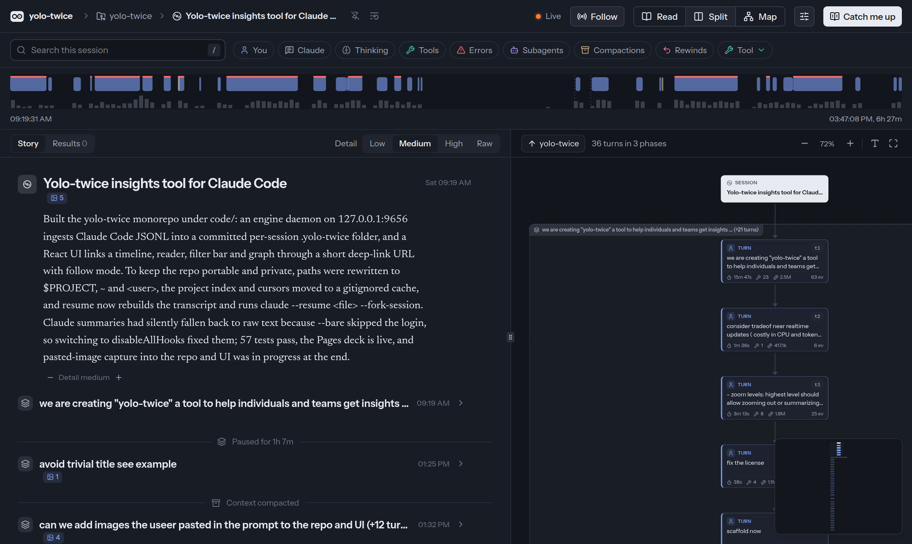
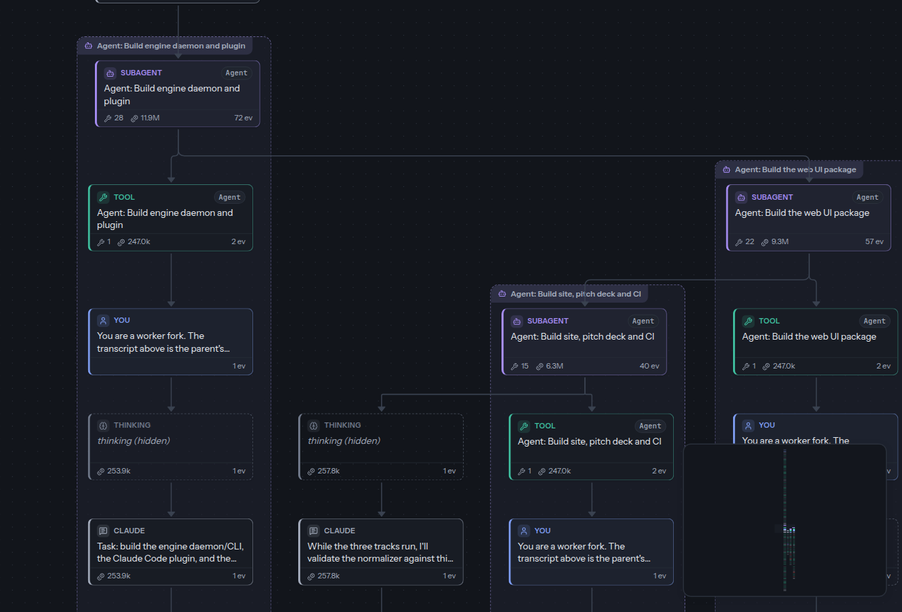

  
Give your AI conversations the attention they deserve.

  
BaselHack 2026 · Matthias Cullmann · Roland Brand · Jan Babin · Thomas Schöller

<!--
Hi, we are yolo-twice. The name: YOLO, "you only live once", is also the nickname for letting an agent run without asking for approval. Such a session happens once and is then gone. We record it with the code, so it can be looked at a second time. We want to talk about a question every team that works with AI coding agents runs into: what did the AI actually do, and why?
-->

---

The scene

# Did we just leak everything?

  

    Open
    Commit the AI sessions #37
    24 hours of AI work+37 files
  

  

    
MR Reviewer

    
Wait. Are our API keys in here?

  

  

    
YOU Author

    
Uh… Claude dealt with that. Somewhere. Let me scroll.

  

<IncomingCall :active="$clicks >= 3" :sound="$renderContext === 'slide'" avatar="./assets/silo-avatar.png" />

<!--
We built yolo-twice for 24 hours with an AI agent, and committed every session. The reviewer: are our API keys in here? The author: Claude dealt with that. Somewhere.

[click] And then the tech lead calls: "Are you crazy? You have been pushing your whole internal development context for the last 24 hours?" (The ringtone plays in the audience window only.)
-->

---

Scrolling back

# The transcript

  
<em>Claude Code</em>

  
↑ 9,870 more lines

<pre>
<b class="u">&gt;</b> .yolo-twice contains my home folder ~ as absolute path. can we replace it with the tilde version?
  goals: better portability to the team, no disclosure of user names and FS layout, less tokens
<b class="dot">●</b> This is a new task, so I'll start the plan fresh. First I'll measure where absolute paths occur.
<b class="dot">●</b> <b>Bash</b>(Count absolute paths, slugs and usernames across .yolo-twice files)
  └  296 project paths · 65 home paths · 120 slugs · 78 bare user names
<b class="dot">●</b> <b>WebFetch</b>(https://code.claude.com/docs/en/cli-reference)
  └  Output too large (50.6KB). Full output saved to a file
<b class="dot">●</b> <b>Bash</b>(Read full --resume entry and local fork-session help)
  └  --resume, -r  Resume a conversation by session ID …
<b class="dot">●</b> <b>AskUserQuestion</b>(How should resume treat the paths?)
<b class="dot">●</b> <b>Write</b>(~/.claude/plans/pasted-content-id-bba5-we-are-transient-nautilus.md)
<b class="u">&gt;</b> resume
<b class="dot">●</b> Resuming the approved plan. First I'll check where the repo stands.
<b class="dot">●</b> <b>Bash</b>(Verify regenerated project.json and conclude the merge)
<b class="dot">●</b> <b>Bash</b>(Install, test, typecheck and build after the merge)
  └  39 pass · 0 fail
<b class="dot">●</b> <b>Write</b>($PROJECT/code/packages/core/src/anonymize.ts)
  └  File created successfully
<b class="dot">●</b> Now wiring it into ingest: path anonymization runs after secret redaction.
<b class="dot">●</b> <b>Bash</b>(Add anonymizer and ingest tests, run them)
  └  5 pass · 1 fail: Received "alicesmith and &lt;user&gt;.cooper and &lt;user&gt;@example.com"
<b class="dot">●</b> <b>Bash</b>(Fix username boundary after the name, rerun all tests)
  └  Ran 45 tests across 9 files · 0 fail
<b class="dot">●</b> <b>Bash</b>(Expand paths on resume, write to cache, fork the session; update CLI)
<b class="dot">●</b> <b>Bash</b>(Rebuild fixture session in a scratch project and resume it as a fork)
  └  Exit code 1
<b class="dot">●</b> <b>Bash</b>(Resume the rebuilt transcript as a fork with login, hooks off)
<b class="dot">●</b> <b>Bash</b>(Scan before, restart engine to rebuild with v3, scan after)
  └  before: ~ 435 · &lt;user&gt; 88 · after: ~ 3 · &lt;user&gt; 0
<b class="dot">●</b> <b>Bash</b>(Widen the other-homes rule, bump normalizer to 4, run tests)
<b class="dot">●</b> The secret scan matched something in the session's events, and my command committed anyway.
<b class="dot">●</b> <b>Bash</b>(Show what the secret scan matched)
  └  grep -lE 'sk-ant-api|ghp_[A-Za-z0-9]{30}' …   (the scan's own command)
<b class="dot">●</b> .yolo-twice/ is now portable and anonymous.
<b class="u">&gt;</b> implement the project.json split
<b class="dot">●</b> <b>Bash</b>(Move cursor, project index and open summaries to the cache)
<b class="dot">●</b> <b>Bash</b>(Run all tests after the layout change)
  └  44 pass · 1 fail: ENOENT .yolo-twice/project.json
<b class="dot">●</b> <b>Bash</b>(Replace --bare with disableAllHooks in the summarizer)
<b class="u">&gt;</b> build in ~/Downloads/Yolo/1793441711665.jpg to the title slide
<b class="dot">●</b> <b>Bash</b>(Copy the image into the deck and make it the title slide background)
<b class="dot">●</b> <b>Bash</b>(Build the deck, serve it under its Pages base path, screenshot slide 1)
<b class="u">&gt;</b> commit and push changes
<b class="dot">●</b> <b>Bash</b>(Stage .yolo-twice and scan the staged additions for real secrets and home paths)
  └  secret hits: 0 · home paths: 0 · 37 files changed
<b class="dot">●</b> <b>Bash</b>(Commit the index refresh and push main)
</pre>
  
↓ 180 more lines

<!--
The answer is on this screen. Three times: the leak count, a false alarm, the scan before the push. Nobody finds it by scrolling. And this is one screen of 24 hours.
-->

---
layout: center
class: text-center
---

Demo

# Live demo

  
<em>Claude Code</em>

<pre>
&#36; claude plugin install yolo --marketplace bar9/yolo-twice
<b class="u">&gt;</b> /yolo:twice
</pre>

<!--
One command installs it. Next slide: the real product, live. We click through it.
-->

---
layout: full
---

<HandOver ui="http://localhost:9656/yolo-twice" script="privacy" />

<!--
The deck hands over to the real product (.yolo-twice/demos/privacy.json). Page Down steps; after step 6 it comes back to the next slide, and Page Up from step 1 returns to the slide before. Needs the engine: /yolo:twice.
1. Yes. 24 hours of AI work, in the repo.
2. [Page Down] We asked first. One word finds it: "disclosure", our own prompt.
3. [Page Down] The agent counted every leak. Then masked them: $PROJECT, ~.
4. [Page Down] A scan alarm. False: it caught its own pattern.
5. [Page Down] Before the push: 0 secrets, 0 home paths.
6. [Page Down] The whole fix. One map.
-->

---

Benefits

# Find, share, review, continue

  
<em>terminal</em>

<pre>
find
&#36; git log --oneline -- .yolo-twice/sessions
63a2b55 Add a newsletter sign-up
<i></i>
share
→ localhost:9656/api/7f825b/t4
<i></i>
review
&#36; gh pr diff 142 --name-only | grep yolo
.yolo-twice/sessions/7f825bc9/events.ndjson
<i></i>
continue
&#36; yolo-twice resume 7f825bc9
✓ claude --resume … --fork-session
</pre>

<!--
The same three questions, plus one. Sessions can be found later: they stay with the project, also when people move on. A link opens a specific step for others on the team. Reviewers can see the reasoning in addition to the resulting code. And a colleague can resume the session on their own machine. Back to the reviewer: they open the link, land on the exchange, and have the answer. As more code is written with AI agents, it becomes more useful to know why it was written that way.
-->

---

Outlook

# Outlook

  <svg class="growth-line" viewBox="0 0 100 100" preserveAspectRatio="none" aria-hidden="true">
    <defs><linearGradient id="grow" x1="0" x2="1"><stop offset="0" stop-color="#f25c05" stop-opacity=".12" /><stop offset="1" stop-color="#f25c05" /></linearGradient></defs>
    <path d="M 0 74 C 6 71, 12 68.5, 16.7 66.7 S 40 55, 50 48.9 S 76 22, 83.3 9.1 S 96 -8, 99 -14" fill="none" stroke="url(#grow)" stroke-width="3" stroke-linecap="round" vector-effect="non-scaling-stroke" />
  </svg>
  
<i class="node"></i>
<b>Agent agnostic</b><ul><li>Use and promote open formats</li><li>Agent interop</li><li>Integrate <a href="https://github.com/bar9/yolo-twice/issues/4">OpenCode</a></li></ul>

  
<i class="node"></i>
<b>Team work</b><ul><li>Build a joint knowledge base</li><li>Discuss</li><li>Automated insights</li></ul>

  
<i class="node"></i>
<b>Global community</b><ul><li>Coders become agentic engineers</li><li>Open data on prompting, for future research</li></ul>

<!--
Where we would take it. Agent agnostic: open formats instead of one vendor's, sessions that work across agents, and OpenCode support next (issue #4). Team work: a joint knowledge base built from sessions, discussion on the exact step, and insights generated automatically. Global community: coders are becoming agentic engineers, and open data on how people prompt can enable future research.
-->

---

Your turn

# Try it yourselves

Install the Claude Code plugin, then open your own session.

  

    
<em>terminal</em>

<pre># Install
&#36; claude plugin install yolo-twice \
    --marketplace bar9/yolo-twice
# In Claude Code, inside your project
<b class="u">&gt;</b> /yolo-twice:yolo-twice</pre>
  

  

    

      <svg class="try-pumpkin" viewBox="0 0 64 48" role="img" aria-label="Pumpkin">
        <path d="M30 10c-2-7 1-10 7-10-1 4-2 7-2 10" fill="#4ac26b"/>
        <path d="M32 10C19 1 7 11 7 26c0 14 10 22 25 22s25-8 25-22C57 11 45 1 32 10Z" fill="#fd5f02"/>
        <path d="M18 17c-3 5-4 13-2 20M46 17c3 5 4 13 2 20" fill="none" stroke="#d74800" stroke-width="2" opacity=".7"/>
        <path d="m19 25 7-5 2 8-9-3Zm26 0-7-5-2 8 9-3ZM20 34c7 9 17 9 24 0l-5 1-3-4-4 4-4-4-3 4-5-1Z" fill="#11163f"/>
      </svg>
      
    

    <a class="try-url" href="https://bar9.github.io/yolo-twice/">bar9.github.io/yolo-twice/</a>
  

<!--
Here is how to try it: install the Claude Code plugin, then use the slash command in a project. The QR code opens the site, which has the installation guide. Leave this slide up for the audience to scan.
-->

---

Backup · The gap

# Find, share, review: not for AI sessions

  
<em>terminal</em>

<pre>
find
&#36; git log -- ~/.claude/projects
fatal: '~/.claude/projects' is outside repository
<i></i>
share
&#36; claude --resume 7f825bc9
› opens the whole session, at the end,
  on the machine where it ran
<i></i>
review
&#36; gh pr diff 142 --name-only
… 6 files of code
› 0 files of conversation
</pre>

<!--
Find, share, review: three things every team does with code, every day. "Where is last Tuesday's session?" It is not in the project; it leaves with the laptop. "Look at the moment it chose this." There is no link to send. "Why does the code look like this?" Reviews see the result, not the reasoning. More design decisions are made in these conversations, and they are rarely part of a review.
-->

---

Backup · The idea

# Keep the session with the code

  
<em>terminal</em>

<pre>
&#36; git show --stat HEAD
commit 63a2b55
    Add a newsletter sign-up
<i></i>
 index.html                       |  42 ++++-
 server.js                        |  31 +++
 .yolo-twice/sessions/7f825bc9/
   meta.json                      |   9 +
   events.ndjson                  | 412 ++++++++
   structure.json                 |  96 ++
</pre>

<!--
We already know how to make work visible to a team: put it in version control. We store the AI session in the project, next to the code it produced, so it can be versioned, shared and looked at in the same pull request. Existing viewers show a transcript on one machine; we learned from them. The difference is that the session becomes part of the project, readable at several levels of detail.
-->

---

Backup · Record

# Recorded in the background

<Pele text="flowchart LR
  CC[AI coding session] --> ENG[yolo-twice, on your machine]
  ENG --> R[secrets removed]
  R --> STORE[(saved in the project)]" />

<!--
Nothing to do: it records while you work. Passwords, keys and personal folder names are removed before anything is saved. The files are plain JSON and text that other tools can read, and there is one folder per session, so sessions from several people do not conflict. For developers: a Claude Code plugin with hooks plus a small local engine. You decide whether to commit it.
-->

---

Backup · Read

# From one line to every detail

<!--
The session in yolo-twice: a timeline at the top, the story on the left, the map on the right. Detail goes from a one-line summary through chapters and single exchanges down to the raw log. Some readers only need the top line; others go down to the raw log. The structure needs no AI; the short summaries are written by Claude, cached, and only as often as you allow.
-->

---

Backup · Map

# Every step, every helper agent

<!--
One exchange as a map: here three helper agents were started in parallel, each in its own frame with its own steps. Changes of plan stay visible as their own branch; that is where the reviewer finds where the CAPTCHA was dropped.
-->

---

Backup · Under the hood

# Implementation

  
<b>Incremental</b>

  
<b>Redacted on the way in</b>

  
<b>Structure without AI</b>

  
<b>Cached summaries</b>

  
<b>Live</b>

  
<b>Resumable anywhere</b>

TypeScript · Bun · React · Claude Code plugin · 63 tests · MIT

<!--
For the technical audience, briefly. Incremental and repeatable: it reads only what is new, and running it twice gives identical output. Redaction runs before anything is written; paths become $PROJECT and ~. Chapters, exchanges, tool calls, helper agents and changes of plan come straight from the transcript, with no model call. Summaries are written by Claude, cached by content, and only as often as the attention setting allows; the cost is shown. Hooks notify a local engine and the browser updates live. resume rebuilds a working Claude Code transcript on any teammate's machine.
-->
