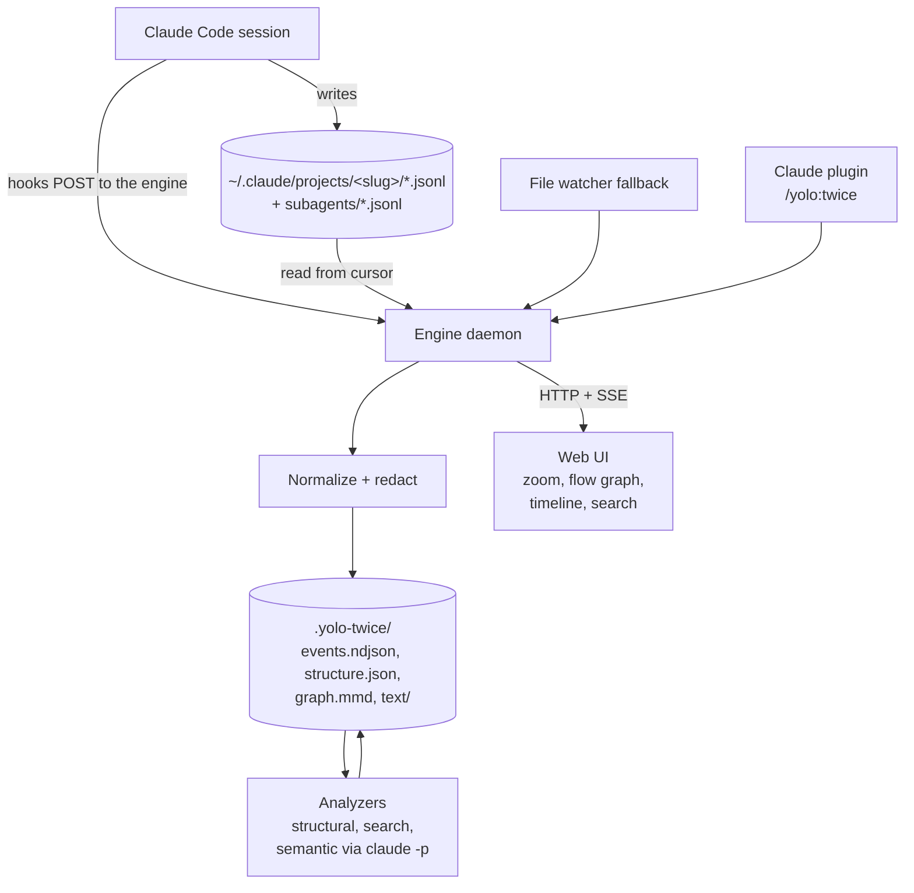
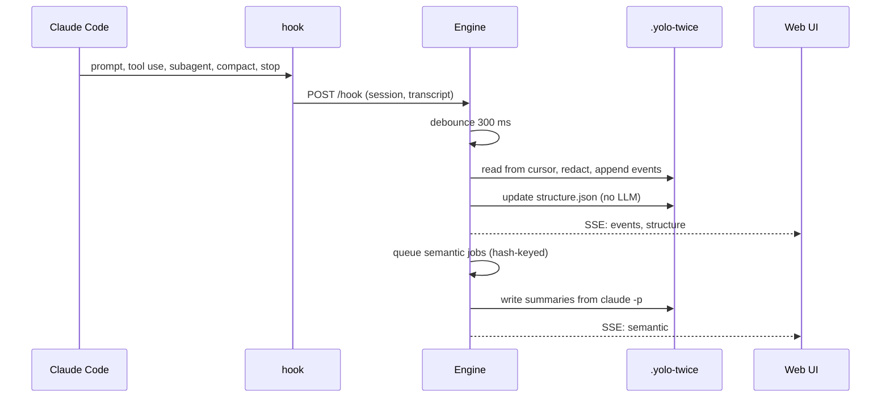
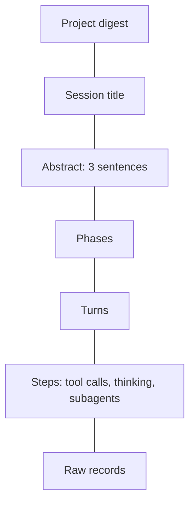

# How it works

Written for developers who want to know what runs where. The authoritative design lives in
[documentation/design.md](https://github.com/bar9/yolo-twice/blob/main/documentation/design.md).

## Architecture

## Live pipeline

The transcript file lags the live conversation, so every hook triggers a re-read from the
cursor and the next hook or watcher event picks up anything missed. If the engine is not
running the hook fails silently and the watcher catches up when `/yolo:twice` starts it.

## Semantic zoom: two axes

Zoom is not a fixed ladder. It has two independent axes, and both apply at every node,
including the top.

**Structural axis** (what unit is shown):

| Level | Unit | Source | LLM needed |
|---|---|---|---|
| L-1 | Project: all sessions of this project | session list | no (digest: yes) |
| L0 | Session: title, duration, cost, outcome | title and cost records | no |
| L1 | Phases: "setting up auth", "debugging tests" | semantic analyzer; structural fallback splits on compaction, long gaps and topic-changing prompts | yes (fallback no) |
| L2 | Turns: user prompt to final assistant text, subagent runs collapsed into one node | parent chain | no |
| L3 | Steps: tool calls with results, thinking, subagent internals | content blocks | no |
| L4 | Raw record | JSONL line | no |

**Text axis** (how much text a node shows), in the stretchtext sense: any text can be
collapsed in place to a shorter form and expanded back.

| Granularity | Target | Example at L0 |
|---|---|---|
| `title` | one line | "Migrated auth to OIDC, tests green" |
| `abstract` | up to three sentences | what, why, outcome |
| `summary` | a paragraph or short list | the phases and the decisions in each |
| `full` | the complete text | all turns |

The two axes combine: zooming out at the top collapses the session summary to a title, and
one step further shows the project as a list of session titles, which can itself be
summarized into a project digest. Zooming in on a long tool result collapses it to an
abstract first, then expands to full text. A long paragraph is never the end of the road.

Every (node, granularity) pair is a derived artifact keyed by the hash of the node's input
text plus the analyzer version, produced lazily or by a structural fallback (head and tail
plus counts) when no LLM result exists yet.

## Flow graph

The engine emits the graph as mermaid text in `sessions/<id>/graph.mmd`. Nodes are turns by
default, expandable to steps. Edges: sequence, tool call to tool result, subagent start to
its transcript, and dotted rewind edges where one parent has several children. Zooming out
merges turns into phase nodes, like map tiles. The UI, this site and the pitch deck all
render that text with [pele](https://pele.run/), so one source renders everywhere.

## Idempotency

1. Event identity is the record uuid. Re-ingesting the same line is a no-op.
2. Each source file has a cursor. On start the engine resumes from it; if the file shrank or
   its head changed, the session is rebuilt from zero.
3. Every derived artifact is keyed by the hash of its inputs plus analyzer name and version.
4. Files are written atomically with sorted keys, so git diffs are small and merges are sane.
5. `/yolo:twice` reuses a healthy engine instead of starting a second one.
6. Redaction runs before anything is written. The original stays in `~/.claude` untouched.
