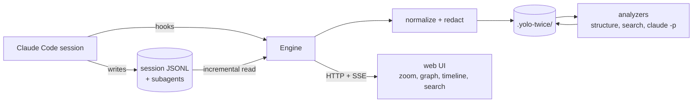

<div class="status-banner">Under construction at <a href="https://www.baselhack.ch">BaselHack 2026</a> (30 Oct to 1 Nov). The install command is the target for the first release and does not work yet.</div>

## The problem

A long Claude Code session leaves behind megabytes of JSONL: hundreds of turns, tool calls,
subagent transcripts, rewinds and compactions. Reading it as a chat list does not scale, and
the existing viewers, good as they are, show exactly that list. You either micro-manage every
tool call or you go full yolo and lose track of what happened.

## Install

One command, in a terminal where Claude Code is installed (version 2.1.275 or newer, Node 22 or newer):

```
claude plugin install yolo-twice --marketplace bar9/yolo-twice
```

Then, inside any Claude Code session, run `/yolo-twice` to start the engine for the current
project and open the UI. See [Install and use](/install).

## How it works



Claude Code hooks tell the engine that something happened. The engine reads the new lines of
the session transcript from its cursor, normalizes them into one event per line, redacts
secrets, and appends them to `.yolo-twice/` in your repo. Structural levels are derived
without any model call. Summaries are produced by the Claude Code CLI itself in headless
mode, cached by content hash, only as eagerly as the attention slider allows.

Everything derived is plain JSON and mermaid, so you can commit it or gitignore it.
Raw transcripts stay in `~/.claude`.
