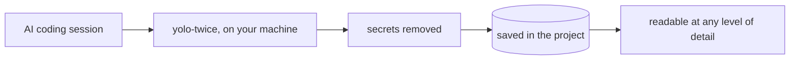

## The problem

An AI agent works for three hours. The pull request is +2,400 lines. A reviewer asks a fair
question: *why did it choose this approach, and who decided to drop that check?*

The answer exists. Claude Code keeps a readable transcript of every session. But three hours
of work is hundreds of screens, read in order, with no overview and no way to point at a
decision, and it stays on the laptop where it ran. For the rest of the team the session is a
black box: you can't find it later, you can't send a link to the moment that matters, and the
review sees the code but never the conversation that produced it.

More and more engineering decisions are made in these conversations. None of them are
reviewed.

## The idea: keep the conversation with the code

yolo-twice treats an AI session like source code. It records the session while you work,
removes secrets, and saves it in the project as plain files: versioned, shareable, reviewable
and resumable. One change, one commit: the code, and the conversation that produced it.

Then it makes the session readable. Start from one line, open three sentences, then the
chapters, a single exchange, or the raw log. Or look at the session as a map, where every
detour, helper agent and change of plan stays visible.



Existing transcript viewers show you a list on one machine, and we learned a lot from them
(see [credits](/credits)). yolo-twice makes the session part of the project.

As AI writes more of our software, knowing *why* it was written that way becomes part of
quality, trust and accountability. That is the transparency we are after, built on tools teams
already use.

## Built with itself

We used yolo-twice to build yolo-twice. The repository keeps the AI sessions that built it,
right next to its code, in
[`.yolo-twice/`](https://github.com/bar9/yolo-twice/tree/main/.yolo-twice). Clone it, run
`/yolo-twice:yolo-twice`, and read how the project came to be.

## Install

In a terminal where Claude Code is installed (version 2.1.275 or newer, Node 22 or newer):

```
claude plugin install yolo-twice --marketplace bar9/yolo-twice
```

Then, inside any Claude Code session, run `/yolo-twice:yolo-twice` to start recording this
project and open the reader. See [Install and use](/install) for all commands.

## What's next

Support for AI agents beyond Claude Code, comments on saved sessions, and letting the AI
search its own history.

## Learn more

- [How it works](/how-it-works): the engine, the zoom levels, the flow graph and why every
  run gives the same output.
- [Attention slider](/attention): how much AI summarizing you want, from "every turn" to
  "only when I ask", and what it costs.
- [Credits](/credits): the projects that came before us.
