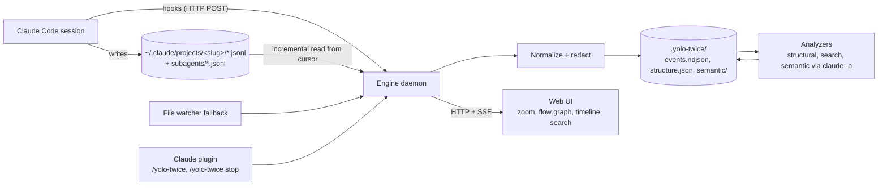

# yolo-twice: design and hackathon plan

Status: draft, 31 Oct 2026, decided together in the kickoff Q&A. Edit freely.

## 1. Context

Long Claude Code sessions are black boxes: a single session JSONL grows to megabytes, spawns
subagent transcripts, branches on rewind and gets compacted. Existing viewers render this as a
flat chat list. yolo-twice makes a running session navigable at several levels of abstraction,
live, and stores what it learns next to the project so it can be committed or ignored.

Built at BaselHack 2026 (30 Oct to 1 Nov) by four people working AI-driven in parallel.
Demo on 1 Nov is a vertical slice; the architecture is designed for the full vision.

### Decisions taken

| Topic | Decision |
|---|---|
| Deadline | Demo slice on 1 Nov, continue afterwards |
| Pitch features | Semantic zoom, live flow graph, shareable project history. Cross-agent later |
| Event source | Claude Code hooks trigger ingestion; the session JSONL is the source of truth; file watcher as fallback |
| Stack | Node/TypeScript monorepo (pnpm workspaces) |
| Primary user | Developer reviewing their own sessions; team sharing is a later layer on the same data |
| `.yolo-twice` content | Redacted raw events plus derived data, so it is safe to commit |
| LLM analysis | Headless `claude -p` through the user's subscription, hash-cached, never blocking the UI |
| Pitch | Markdown deck on GitHub Pages, reusing the site's mermaid diagrams |

### What exists and what we add

Over a dozen Claude Code transcript viewers exist. The strongest are
[Claudescope](https://github.com/vladar107/claudescope) (8 agents, DuckDB search, MCP server, plugin),
[claude-code-history-viewer](https://github.com/jhlee0409/claude-code-history-viewer) (31 agents, file watch, SSE) and
[cc_transcript_viewer](https://github.com/tim-hua-01/cc_transcript_viewer) (zero dependencies, live tail).
None of them offer abstraction levels, a conversation flow graph, or project-local committable state.
We reuse their parsing knowledge and build the three missing things.

## 2. Architecture



### Packages (monorepo under `code/`)

| Package | Responsibility | Owner |
|---|---|---|
| `packages/core` | Event schema, source adapters (claude-code now, opencode later), redaction, cursor-based incremental reader, `.yolo-twice` store | A |
| `packages/engine` | Daemon: HTTP API, SSE stream, `/hook` endpoint, watcher fallback, analyzer queue, pid/port lifecycle, CLI (`yolo-twice start|stop|status|index`) | A |
| `packages/analyzers` | Structural tree (L0 to L4), full-text search, semantic phase summaries and cluster labels via `claude -p`, cost rollups | B |
| `packages/ui` | Vite + React web app: zoom view (stretchtext), flow graph, timeline, search, live updates over SSE | C |
| `plugin/` | Claude Code plugin: `plugin.json`, `commands/yolo-twice.md`, `hooks/hooks.json`, `bin/yolo-twice` | D |
| `site/` and `assets/pitch/` | VitePress site and Slidev deck, both with native mermaid, deployed to GitHub Pages by one Actions workflow | D |
| `fixtures/` | Two or three real sessions, redacted, so B and C can develop without the engine running | D |

## 3. Live pipeline


The transcript file lags the live conversation, so every hook triggers a re-read from the
cursor and the next hook or watcher event picks up anything missed. Hooks of type `http` post
straight to the engine; if the engine is not running the hook fails silently and the watcher
catches up when `/yolo-twice` starts it.

## 4. Data model

### Normalized event (one JSON line in `events.ndjson`)

Field names follow OpenTelemetry GenAI conventions where they exist (`gen_ai.*` equivalents noted in the schema file).

```json
{
  "id": "record uuid, or sha256 of the line for records without one",
  "ts": "2026-10-31T08:12:03.702Z",
  "session": "34b27ceb-...",
  "agent": "claude-code",
  "agent_id": null,
  "parent": "parentUuid or null",
  "kind": "user.prompt | assistant.text | assistant.thinking | tool.call | tool.result | subagent.start | subagent.stop | compaction | cost | title | system | meta",
  "tool": { "name": "Bash", "call_id": "toolu_..." },
  "text": "redacted content",
  "model": "claude-fable-5-1",
  "usage": { "input_tokens": 0, "output_tokens": 0, "cache_read_tokens": 0 },
  "redacted": { "count": 2, "rules": ["api-key", "env-value"] },
  "src": { "file": "relative path under ~/.claude", "line": 123 }
}
```

Mapping from Claude Code records observed in version 2.1.31x:
`user`/`assistant` records with `message.content` blocks (`text`, `thinking`, `tool_use`, `tool_result`),
`parentUuid` links, `isSidechain` and `agentId` for subagents (files in `<session>/subagents/agent-*.jsonl`
with a `.meta.json` giving agent type and spawning `toolUseId`), compaction `summary` records,
`ai-title` / `custom-title` / `agent-name`, `cost-state` (total cost and per-model usage),
`system` with subtype `turn_duration`, `file-history-snapshot`, `api-request*` (dropped, internal).
Unknown record types become `kind: meta` and never crash the reader.

### Abstraction levels (the zoom)

| Level | Unit | Source | LLM needed |
|---|---|---|---|
| L0 | Session: title, duration, cost, outcome | title and cost records | no |
| L1 | Phases: "setting up auth", "debugging tests" | semantic analyzer; structural fallback splits on compaction, long gaps and topic-changing prompts | yes (fallback no) |
| L2 | Turns: user prompt to final assistant text, subagent runs collapsed into one node | parent chain | no |
| L3 | Steps: tool calls with results, thinking, subagent internals | content blocks | no |
| L4 | Raw record | JSONL line | no |

Each node has `id`, `level`, `children`, `span` (first and last event id), `label` and
optional `summary`. The UI expands any node in place (stretchtext), so the user can read the
whole session at one level and dive where needed.

### Flow graph

Nodes are L2 turns by default, expandable to L3. Edges: `parent` (sequence), `tool.call` to
`tool.result`, `subagent.start` to its transcript, and branch edges where one parent has several
children (a rewind). Layout with elkjs or dagre inside `@xyflow/react`.

## 5. `.yolo-twice` layout and idempotency

```
.yolo-twice/
  config.json                    # schema version, sources, redaction rules, enabled analyzers
  engine.json                    # pid, port, started at   (gitignored)
  cache/                         # search index, temp      (gitignored)
  sessions/<session-id>/
    source.json                  # origin path, agent, cursor {bytes, lines, size, mtime, head hash}
    events.ndjson                # redacted normalized events, append-only
    structure.json               # L0 to L3 tree
    semantic/<input-hash>.json   # summaries and labels, keyed by input hash + analyzer version
  annotations/                   # user notes, later
  .gitignore                     # engine.json, cache/
```

Rules that make stop, resume and re-run safe:

1. Event identity is the record uuid. Re-ingesting the same line is a no-op.
2. Each source file has a cursor. On start the engine resumes from it; if the file shrank or
   the head hash changed, it re-reads from zero and rewrites that session's files.
3. Every derived artifact is keyed by sha256 of its input event ids plus content plus analyzer
   name and version. Existing key means skip. This is what makes `claude -p` affordable.
4. Files are written atomically (temp file then rename) with sorted keys and stable
   formatting, so git diffs are small and merges are sane.
5. `/yolo-twice` is idempotent: it checks `engine.json`, probes the port, and reuses a healthy
   engine instead of starting a second one.
6. Redaction runs before anything is written: API keys, tokens, JWTs, private keys, env
   values and configurable patterns are replaced with `[redacted:<rule>]`; tool results above a
   size limit keep head and tail plus a hash. The original stays in `~/.claude` untouched.

## 6. Plugin and install

```
plugin/
  .claude-plugin/plugin.json
  commands/yolo-twice.md       # runs !`${CLAUDE_PLUGIN_ROOT}/bin/yolo-twice $ARGUMENTS` and prints the URL
  hooks/hooks.json             # SessionStart, UserPromptSubmit, PostToolUse, SubagentStart, SubagentStop,
                               # PreCompact, PostCompact, Stop, SessionEnd -> http://127.0.0.1:<port>/hook
  bin/yolo-twice               # thin wrapper: npx -y yolo-twice@<pinned> "$@"
```

The slash command uses the command file's inline shell execution, so `/yolo-twice` starts the
engine for the current project (`cwd` to project slug), opens the browser on the current
session, and `/yolo-twice stop` and `/yolo-twice status` work without any model turn.

A `.claude-plugin/marketplace.json` at the repo root lets the README promise one line:

```
claude plugin marketplace add <org>/yolo-twice && claude plugin install yolo-twice@yolo-twice
```

Requires Node 22 or newer. A standalone binary (Node SEA or `bun build --compile`) is a
post-hackathon item.

## 7. Interfaces to freeze in hour one

- `packages/core/schema/event.schema.json` and `structure.schema.json` (zod, exported types)
- `.yolo-twice` layout above
- HTTP API: `GET /api/sessions`, `GET /api/sessions/:id/events?after=<id>`,
  `GET /api/sessions/:id/structure`, `GET /api/sessions/:id/semantic`,
  `GET /api/search?q=&session=`, `GET /api/stream` (SSE: `events`, `structure`, `semantic`),
  `POST /hook`, `GET /health`
- Fixtures in `code/fixtures/<session>/` in exactly the `.yolo-twice/sessions/<id>/` shape

With these frozen, the four tracks run in parallel against fixtures and meet at integration.

## 8. Hackathon timeline

| Hours | A: core + engine | B: analyzers | C: UI | D: plugin, site, pitch |
|---|---|---|---|---|
| 0 to 1 | Scaffold monorepo, freeze schemas and API | Review fixtures | UI shell, routing, SSE client | Export and redact 3 fixtures, plugin skeleton |
| 1 to 5 | Reader, normalizer, redaction, cursor, ndjson store, CLI `index` | Structural tree L0 to L3 from fixtures | Zoom view from fixture structure.json | hooks.json, command, README install line, Actions to Pages |
| 5 to 10 | Engine: HTTP, SSE, `/hook`, watcher, lifecycle | Search index, `claude -p` phase summaries with hash cache | Flow graph, timeline, search, live patches | VitePress site, Slidev deck, demo script |
| 10 to 16 | Integration on a live session | Cluster labels, cost rollups | Polish, empty states, error states | Record fallback demo video, rehearse pitch |

Post-hackathon roadmap: opencode adapter (SQLite reader, ACP `session/load` as the generic
path), MCP server exposing search and summaries back to Claude, annotations and team sharing,
embedding-based clustering, OpenTelemetry export, standalone binary.

## 9. Site and pitch

The README carries the mermaid diagrams and renders them on GitHub as-is. The VitePress site
reuses the README sections. The Slidev deck lives in `assets/pitch/`, renders the same mermaid
sources, exports to PDF and deploys under `/pitch` on the same Pages site.

Pitch arc, three minutes: a multi-megabyte session JSONL on screen as the problem; one
sentence on why existing viewers do not solve it; live demo zooming out to phases, in to a
tool call, and the flow graph showing a rewind branch and subagents; the architecture diagram;
the one-line install; roadmap.

## 10. Verification

- Unit: normalizer against fixtures; idempotency test runs `index` twice and asserts identical bytes; resume test truncates the cursor and asserts identical output.
- Redaction test seeds fake keys and tokens into a fixture and asserts none reach `events.ndjson`.
- Engine e2e: start on a copy of a fixture, append lines to the JSONL, assert the SSE event arrives within one second and the UI renders it.
- Live: `claude --plugin-dir ./code/plugin`, run `/yolo-twice`, send a prompt, see the UI update; `/yolo-twice stop` leaves no process.
- Clean install: follow the README on a machine without the repo.

## 11. Risks

- Transcript lag behind hooks: mitigated by debounce plus re-read on every subsequent event.
- `claude -p` latency and cost: cache by hash, queue in background, structural levels never wait for it.
- Format drift between Claude Code versions: pin to the record `version` field, tolerate unknown types.
- Privacy: redaction is mandatory before write; cache and engine state are gitignored by default.
- Scope: cross-agent support stays out of the demo.
