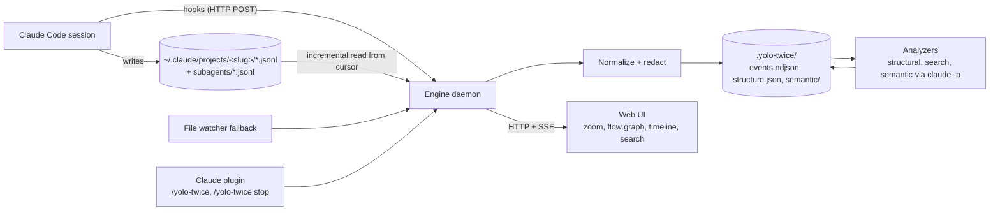
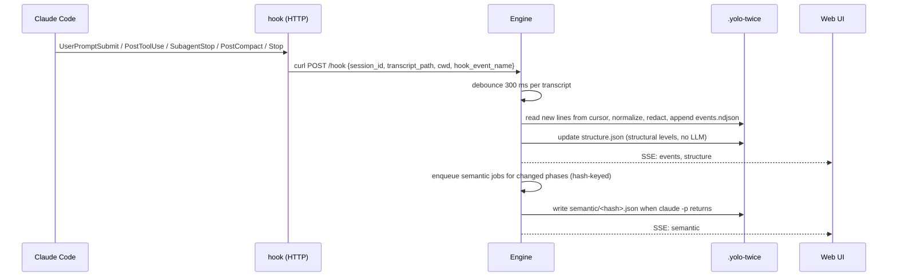

# yolo-twice: design and hackathon plan

Status: draft, 31 Oct 2026, decided together in the kickoff Q&A. Edit freely.

## 1. Context

Long Claude Code sessions are black boxes: a single session JSONL grows to megabytes, spawns
subagent transcripts, branches on rewind and gets compacted. Existing viewers render this as a
flat chat list. yolo-twice makes a running session navigable at several levels of abstraction,
live, and stores what it learns next to the project so it can be committed or ignored.

Built at BaselHack 2026 (30 Oct to 1 Nov) by four people working AI-driven in parallel.
Demo on 1 Nov is a vertical slice; the architecture is designed for the full vision.

### Decisions taken

| Topic | Decision |
|---|---|
| Deadline | Demo slice on 1 Nov, continue afterwards |
| Pitch features | Semantic zoom, live flow graph, shareable project history. Cross-agent later |
| Event source | Claude Code hooks trigger ingestion; the session JSONL is the source of truth; file watcher as fallback |
| Stack | TypeScript monorepo under `code/`, bun for workspaces, tests and dev; the shipped engine runs on Node 20 or newer |
| Primary user | Developer reviewing their own sessions; team sharing is a later layer on the same data |
| `.yolo-twice` content | Redacted raw events plus derived data, so it is safe to commit |
| LLM analysis | Headless `claude -p` through the user's subscription, hash-cached, never blocking the UI |
| Pitch | Markdown deck on GitHub Pages, reusing the site's mermaid diagrams |
| Update cadence | Attention slider with four detents (micro, attentive, balanced, yolo); ingestion always live, semantic work and UI attention follow the slider |

### Design principles

- **Idempotency.** Every derived artifact is a pure function of its input and the analyzer
  version. Stop, resume, re-run, or run two writers at once: the bytes come out the same.
- **Addressability.** The URL is a deep link to the complete viewer state: project, session,
  focus, time window, selection, query, filters and text length. Any view can be bookmarked or
  pasted to a teammate and opens identically. URLs are as short as possible: defaults are
  omitted, ids are the shortest unique prefix.

### What exists and what we add

Over a dozen Claude Code transcript viewers exist. The strongest are
[Claudescope](https://github.com/vladar107/claudescope) (8 agents, DuckDB search, MCP server, plugin),
[claude-code-history-viewer](https://github.com/jhlee0409/claude-code-history-viewer) (31 agents, file watch, SSE) and
[cc_transcript_viewer](https://github.com/tim-hua-01/cc_transcript_viewer) (zero dependencies, live tail).
None of them offer abstraction levels, a conversation flow graph, or project-local committable state.
We reuse their parsing knowledge and build the three missing things.

## 2. Architecture



### Packages (monorepo under `code/`)

| Package | Responsibility | Owner |
|---|---|---|
| `packages/core` | Event schema, source adapters (claude-code now, opencode later), redaction, cursor-based incremental reader, `.yolo-twice` store | A |
| `packages/engine` | npm package `yolo-twice`: one daemon per machine on `127.0.0.1:9656`, HTTP API, SSE stream, `/hook` endpoint, watcher fallback, analyzer queue, lifecycle in `~/.yolo-twice/`, CLI (`yolo-twice start|open|stop|status|index|mode|hook`) | A |
| `packages/analyzers` | Structural tree (L0 to L4), full-text search, semantic phase summaries and cluster labels via `claude -p`, cost rollups | B |
| `packages/ui` | Vite + React web app: zoom view (stretchtext on two axes), flow graph rendered from mermaid text with pele, timeline, search, live updates over SSE | C |
| `plugin/` | Claude Code plugin: `plugin.json`, `commands/yolo-twice.md`, `hooks/hooks.json`, `bin/yolo-twice` | D |
| `site/` and `pitch/` (under `code/`) | VitePress site and Slidev deck, mermaid blocks rendered with pele at build time, deployed to GitHub Pages by one Actions workflow; the exported deck goes to `assets/` | D |
| `README.md` | Getting started, single-command install, a humble comparison with existing tools and credits | D |
| `fixtures/` | A synthetic Claude Code project folder (one session with tool calls, a rewind branch, a subagent, a compaction and seeded fake secrets) that every test and the UI mock run against | D |
| `API.md` | The HTTP, SSE and CLI contract the engine implements and the UI codes against | all |

## 3. Live pipeline



The transcript file lags the live conversation, so every hook triggers a re-read from the
cursor and the next hook or watcher event picks up anything missed. The plugin ships command
hooks (a two-line shell script that posts the hook JSON with curl and always exits 0) rather
than Claude Code's `http` hooks, because an `http` hook prints an error into the transcript
whenever the engine is down. One engine serves every project on the machine, which is what
lets the hook target a fixed port.

## 4. Data model

### Normalized event (one JSON line in `events.ndjson`)

Field names follow OpenTelemetry GenAI conventions where they exist (`gen_ai.*` equivalents noted in the schema file).

```json
{
  "id": "record uuid, or sha256 of the line for records without one",
  "ts": "2026-10-31T08:12:03.702Z",
  "session": "34b27ceb-...",
  "agent": "claude-code",
  "agent_id": null,
  "parent": "parentUuid or null",
  "kind": "user.prompt | assistant.text | assistant.thinking | tool.call | tool.result | subagent.start | subagent.stop | compaction | cost | title | system | meta",
  "tool": { "name": "Bash", "call_id": "toolu_..." },
  "text": "redacted content",
  "model": "claude-fable-5-1",
  "usage": { "input_tokens": 0, "output_tokens": 0, "cache_read_tokens": 0 },
  "redacted": { "count": 2, "rules": ["api-key", "env-value"] },
  "src": { "file": "relative path under ~/.claude", "line": 123 }
}
```

Mapping from Claude Code records observed in version 2.1.31x:
`user`/`assistant` records with `message.content` blocks (`text`, `thinking`, `tool_use`, `tool_result`),
`parentUuid` links, `isSidechain` and `agentId` for subagents (files in `<session>/subagents/agent-*.jsonl`
with a `.meta.json` giving agent type and spawning `toolUseId`), compaction `summary` records,
`ai-title` / `custom-title` / `agent-name`, `cost-state` (total cost and per-model usage),
`system` with subtype `turn_duration`, `file-history-snapshot`, `api-request*` (dropped, internal).
A message typed while the agent is busy arrives as a `queued_command` attachment; it becomes
a `user.prompt` with `data.queued` and stays inside the running turn. Background task
notifications arrive in the user role but are `system` events, never human prompts.
Unknown record types become `kind: meta` and never crash the reader.

### Semantic zoom: two axes

Zoom is not a fixed ladder of five levels. It has two independent axes, and both apply at every
node, including the top.

**Structural axis** (what unit is shown):

| Level | Unit | Source | LLM needed |
|---|---|---|---|
| L-1 | Project: all sessions of this project | session list | no (digest: yes) |
| L0 | Session: title, duration, cost, outcome | title and cost records | no |
| L1 | Phases: "setting up auth", "debugging tests" | semantic analyzer; structural fallback splits on compaction, long gaps and topic-changing prompts | yes (fallback no) |
| L2 | Turns: user prompt to final assistant text, subagent runs collapsed into one node | parent chain | no |
| L3 | Steps: tool calls with results, thinking, subagent internals | content blocks | no |
| L4 | Raw record | JSONL line | no |

**Text axis** (how much text a node shows), in the stretchtext sense: any text can be
collapsed in place to a shorter form and expanded back.

| Granularity | Target | Example at L0 |
|---|---|---|
| `title` | one line | "Migrated auth to OIDC, tests green" |
| `abstract` | up to three sentences | what, why, outcome |
| `summary` | a paragraph or short list | the phases and the decisions in each |
| `full` | the complete text | all turns |

The two axes combine: zooming out at the top collapses the session summary to a title, and
one step further shows the project as a list of session titles, which can itself be
summarized into a project digest. Zooming in on a long tool result or a long assistant
message collapses it to an abstract first, then expands to full text. A long paragraph is
therefore never the end of the road: it can always be zoomed out one more step.

Every (node, granularity) pair is a derived artifact under
`sessions/<id>/text/<node-id>.<granularity>.<hash>.json`, keyed by the hash of the node's
input text plus the analyzer version, produced lazily (see the attention slider) or by a
structural fallback (head and tail plus counts) when no LLM result exists yet. Shorter
granularities are built from the next longer one, so the cost is a fold, not a re-read.

Each structure node has `id`, `level`, `children`, `span` (first and last event id) and the
available granularities. The UI expands any node in place, so the user can read the whole
session at one granularity and dive where needed.

### Flow graph

The engine emits the graph as mermaid text in `sessions/<id>/graph.mmd`, one file per
structural level requested. Nodes are L2 turns by default, expandable to L3. Edges: `parent`
(sequence), `tool.call` to `tool.result`, `subagent.start` to its transcript, and branch
edges where one parent has several children (a rewind). Zooming out merges turns into phase
nodes, like map tiles. The UI renders the text with [pele](https://pele.run/) (MIT, from the
Obsidian team), the same renderer the site and the deck use, and attaches click handlers to
the SVG node ids to zoom. Mermaid text is readable, diffable and committable, and renders on
GitHub as-is. If interactivity outgrows SVG, `@xyflow/react` is the fallback.

## 5. `.yolo-twice` layout and idempotency

Rule: **one writer per committed file**. Everything committed belongs to exactly one session,
or is a team setting. Anything that combines sessions, any machine state and any personal
preference is gitignored and rebuilt locally. Two people indexing at the same time therefore
never touch the same committed file, so `.yolo-twice/` never produces merge conflicts.

```
.yolo-twice/
  config.json                    # team settings: redaction rules, analyzers, default attention   (committed)
  local.json                     # personal overrides, e.g. the attention slider                   (gitignored)
  sessions/<session-id>/                                                                            (committed)
    meta.json                    # label, time span, event count, cost: what the project list needs
    events.ndjson                # redacted normalized events, append-only in arrival order
    structure.json               # L0 to L3 tree with available granularities per node
    graph.mmd, graph.L1.mmd      # flow graph as mermaid text, rendered with pele everywhere
    text/<node>.<gran>.<hash>.json   # summaries of finished nodes, keyed by input hash + analyzer version
    images/<sha256-16>.<ext>     # images pasted into prompts, content-addressed (written once, never changed)
  cache/                                                                                            (gitignored)
    project.json                 # L-1 project list, rebuilt from every meta.json
    sources/<session-id>.json    # ingestion cursor: origin path, byte offset, head hash, normalizer version
    text/<session-id>/           # summaries of nodes still at the live tail; they change every turn
    resume/<session-id>.jsonl    # transcripts rebuilt for `yolo-twice resume`
    <session-id>.lock            # per-session ingestion lock
  .gitignore                     # cache/, engine.json, local.json
```

A node is at the live tail while it ends at the session's newest event and the session was
active in the last 30 minutes. Once it is finished, its summary is computed again from the
final input and lands in `text/`. A fresh clone has no cache: the project list is built from
the `meta.json` files and ingestion cursors start empty, which only means a re-read that
dedupes by event id. Folders in the first layout migrate automatically on the next start.

Engine runtime state (`engine.json` with pid and port, `projects.json`, `engine.log`) lives in
`~/.yolo-twice/`, never in the repo.

Rules that make stop, resume and re-run safe:

1. Event identity is the record uuid. Re-ingesting the same line is a no-op, also when two
   writers (two engines, or an engine and `yolo-twice index`) run at once: ingestion of a
   session holds a lock in `cache/`, and the known-id set reloads when the file grows.
2. Each source file has a cursor. On start the engine resumes from it; if the file shrank,
   the head hash changed, or the events were written by an older normalizer version, it
   re-reads from zero and rewrites that session's files once.
3. Every derived artifact is keyed by sha256 of its input event ids plus content plus analyzer
   name and version. Existing key means skip. This is what makes `claude -p` affordable.
4. Files are written atomically (temp file then rename) with sorted keys and stable
   formatting, so git diffs are small and merges are sane.
5. `/yolo-twice` is idempotent: it checks `~/.yolo-twice/engine.json`, probes the port, and
   reuses a healthy engine instead of starting a second one.
6. Resume from the repo: `yolo-twice resume [session]` rebuilds a Claude Code transcript from
   the committed `events.ndjson` (main conversation only, tool call and result pairs kept,
   parent chain re-linked) into the gitignored `cache/resume/`, expands `$PROJECT` and `~`
   to the resumer's own paths, and runs `claude --resume <file> --fork-session`. The fork gets
   a new session id, so a committed session never gets a second writer and resuming a
   teammate's session cannot cause merge conflicts. Nothing is written into `~/.claude`.
7. Paths are portable and anonymous: the project root is written as `$PROJECT`, the home
   folder as `~`, Claude folder names derived from them as `<project-slug>` and `-~-`, other
   machines' homes as `~`, and the login name as `<user>`. This holds for every string of an
   event, including tool inputs and `data`. Switch it off with `redaction.paths: false`.
8. Images pasted into a prompt belong to that prompt event (`data.images`, a list of
   `{ file, media_type, bytes }`) and are stored once under `images/`, named by content hash.
   They bypass text redaction, so `images.keep: false` or `images.max_bytes` in the team config
   leave them out (`omitted: "disabled" | "too-large"`). Resume puts them back into the prompt.
   Images inside tool results (screenshots taken by tools) are not kept.
9. Redaction runs before anything is written: API keys, tokens, JWTs, private keys, env
   values and configurable patterns are replaced with `[redacted:<rule>]`; tool results above a
   size limit keep head and tail plus a hash. The original stays in `~/.claude` untouched.

## 6. Attention slider: micro management to yolo

Not every layer costs the same. Ingestion, redaction, the structural tree and the search index
are cheap and incremental, so they always run near realtime and the data is always complete.
Semantic analysis through `claude -p` is the expensive layer: seconds to minutes per call,
thousands of tokens, and it competes with the user's own session for the same subscription
rate limit. Re-summarizing an open phase after every turn is quadratic in tokens and every
interim result is a cache miss by design.

The slider therefore controls semantic triggers and UI attention, never ingestion. Four
detents, not a continuous value, so each mode is testable:

| Detent | Semantic trigger | Default zoom | UI behaviour |
|---|---|---|---|
| Micro management | every turn: incremental fold summary of the open phase, small model | L3 steps | live ticker, graph re-layout batched to 1 s |
| Attentive | turn label on each Stop hook, phase summary when the phase closes | L2 turns | live, no interim phase summaries |
| Balanced (default) | phase close only: compaction, idle gap, topic change | L1 phases | updates on phase boundaries |
| Yolo | nothing automatic; summaries computed lazily for nodes the UI shows, or on SessionEnd | L0 digest | "catch me up": digest of everything since the user last looked |

Design rules:

- The UI viewport is the demand signal. The UI requests summaries for visible nodes; the
  slider only sets how far ahead the engine prefetches. One code path, different policy.
- Idempotency survives the slider. A closed phase has the same input hash in every mode, so
  its artifact is identical whether computed eagerly or lazily. Interim summaries of open
  phases carry `interim: true` and live in `cache/`, never in the committed `sessions/`.
- Show the cost. Next to the slider the UI displays estimated tokens per hour and update lag
  for the current setting.
- The team default is `attention` in `.yolo-twice/config.json`; each person's choice goes to the
  gitignored `.yolo-twice/local.json`, changeable live from the UI header or
  `/yolo-twice mode <micro|attentive|balanced|yolo>`. The engine reloads it without restart.
- "Catch me up" uses a last-viewed cursor per session stored in the per-user config, so the
  digest covers exactly what the user has not seen.
- `claude -p` jobs run with concurrency one and a per-hour token budget derived from the
  detent; when the budget is exhausted the engine degrades to the next lazier mode and says so
  in the UI.
- The call is `claude -p --bare --no-session-persistence --tools "" --max-turns 1
  --output-format json --json-schema …`: `--bare` skips hooks so our own hooks never recurse,
  `--no-session-persistence` keeps the summarizer out of `~/.claude/projects`, and the schema
  returns clean text. When the CLI is missing or fails, a structural head-and-tail summarizer
  answers instead and the artifact says so.

## 7. Coordinated views and deep links

The UI shows four linked views at once: a filter bar, a timeline scrubber, the reader (the
zoom tree) and the graph. They are projections of one state, and that state is the URL.

- **Focus narrows.** The focus is a node: the project, a session, a phase, a turn or a step.
  The reader is rooted at it, the graph is redrawn one level below it (semantic zoom, no pixel
  zoom), and the timeline axis spans it. A single click focuses (a graph node, a timeline bar, a session; in the reader the ⤢ button, since a row click expands), Esc goes up one level, the
  breadcrumb jumps anywhere above.
- **The window narrows in time.** Dragging on the timeline sets a window that snaps to whole
  bars (turns, or steps inside a turn), so it always maps to nodes in the tree and graph.
- **Filter and query highlight, they never hide.** Matches inside the focus show as ticks on
  the timeline, counts on reader rows and accented graph nodes; everything else is dimmed. An
  empty query with a filter lists every match, for example all your prompts. Query and filter
  combine with AND; filter codes combine with OR.
- **Selection and hover link.** Click selects a node in every view; hover highlights it in
  every view.
- **Follow.** Like `tail -f` or a CI log: the selection stays on the newest step, a focused
  turn moves to the newest turn, and the reader keeps the tail in view. Any navigation
  (click, brush, Esc, scrolling up) stops following; new events are then counted in a
  "N new" button that jumps back to the tail. Filters keep following, like `tail -f | grep`.
  At the project root, follow opens the session that is active right now. Keys: `f` toggles,
  `End` follows.
- **Pinning.** The project is the root. Going into a session pins it, so reset and Esc stay in
  that session; unpinning returns to the project.

URL form:

```
/<project>/<session>/<focus>?t=<from>-<to>&x=<selected>&q=<query>&k=<filters>&z=<text length>
```

| Part | Meaning | Default |
|---|---|---|
| `project` | project folder name, `name~abcd` only when two projects share a name | the engine's last project |
| `session` | shortest unique session id prefix, at least 6 characters; a leading `~` means not pinned | project root |
| `focus` | structure node id such as `p2`, `t7`, `t1.s5` | the session |
| `t` | window in seconds from the focus start, snapped to whole bars | whole focus |
| `x` | selected node | none |
| `q` | text query | none |
| `k` | filters: `u` your prompts, `a` assistant text, `h` thinking, `t` tool calls, `t:Name` one tool, `e` tool errors, `s` subagents, `c` compactions and commands, `r` rewound turns | none |
| `z` | default text length: `t` title, `a` abstract, `s` summary, `f` full | `a` |
| `f` | follow: the view stays on the newest events as they arrive, like `tail -f` | off |

Example: `http://127.0.0.1:9656/yolo-twice/34b27c/t2?k=t,e&x=t2.s4`

Filtering and search run in the browser over the loaded session events, so linking is
instant. At the project root the same filters go to the engine and search every session.

## 8. Plugin and install

```
code/plugin/
  .claude-plugin/plugin.json
  commands/yolo-twice.md       # runs !`${CLAUDE_PLUGIN_ROOT}/bin/yolo-twice $ARGUMENTS` and prints the URL
  hooks/hooks.json             # SessionStart, UserPromptSubmit, PostToolUse, SubagentStart, SubagentStop,
                               # PreCompact, PostCompact, Stop, SessionEnd -> bin/yolo-twice-hook
  bin/yolo-twice-hook          # sh: curl the hook JSON to 127.0.0.1:9656/hook, 2 s timeout, always exit 0
  bin/yolo-twice               # sh: find the engine (env override, repo dev layout, marketplace clone,
                               # finally npx -y yolo-twice@latest) and run it
```

The slash command uses the command file's inline shell execution, so `/yolo-twice` starts the
engine for the current project (`cwd` to project slug), opens the browser on the current
session, and `/yolo-twice stop` and `/yolo-twice status` work without any model turn.

A `.claude-plugin/marketplace.json` at the repo root lets the README promise one command
(the `--marketplace` option adds the marketplace if it is not known yet, verified against
Claude Code 2.1.316):

```
claude plugin install yolo-twice --marketplace bar9/yolo-twice
```

Requires Node 22 or newer. A standalone binary (Node SEA or `bun build --compile`) is a
post-hackathon item.

## 9. Frozen interfaces

- Types: `code/packages/core/src/schema.ts` (zod schemas and TypeScript types for `Event`,
  `StructureNode`, `Config`, `SourceState`, `ProjectIndex`)
- `.yolo-twice` layout above
- HTTP, SSE and CLI: `code/API.md`
- Fixture: `code/fixtures/raw/projects/-tmp-yolo-demo/` is a synthetic Claude Code project
  folder; `code/fixtures/helper.ts` copies it into a temp dir for a test

With these frozen, the tracks run in parallel against the fixture and meet at integration.

## 10. Hackathon timeline

| Hours | A: core + engine | B: analyzers | C: UI | D: plugin, site, pitch |
|---|---|---|---|---|
| 0 to 1 | Scaffold monorepo, freeze schemas and API | Review fixtures | UI shell, routing, SSE client | Export and redact 3 fixtures, plugin skeleton |
| 1 to 5 | Reader, normalizer, redaction, cursor, ndjson store, CLI `index` | Structural tree L0 to L3 from fixtures, mermaid graph emitter | Zoom view from fixture structure.json, pele graph rendering | hooks.json, command, README with install line and credits, pele markdown plugin, Actions to Pages |
| 5 to 10 | Engine: HTTP, SSE, `/hook`, watcher, lifecycle | Search index, `claude -p` text granularities and phase summaries with hash cache | Text-axis zoom, timeline, search, live patches, attention slider | VitePress site, Slidev deck, demo script |
| 10 to 16 | Integration on a live session | Cluster labels, cost rollups | Polish, empty states, error states | Record fallback demo video, rehearse pitch |

Post-hackathon roadmap: opencode adapter (SQLite reader, ACP `session/load` as the generic
path), MCP server exposing search and summaries back to Claude, annotations and team sharing,
embedding-based clustering, OpenTelemetry export, standalone binary.

## 11. Site, pitch and README

Mermaid is the single diagram source everywhere. The README renders it through GitHub's own
renderer. The VitePress site and the Slidev deck render ```mermaid blocks at build time with
[pele](https://pele.run/) (`npm i pele`, MIT, synchronous `render(text)` returning SVG,
themed with `--pele-*` CSS variables), through one small shared markdown-it plugin in
`packages/pele-markdown`. The UI uses the same package for the flow graph. Dark and light
themes come from the CSS variables, no re-render needed.

Repository: `bar9/yolo-twice` on GitHub, public. GitHub Pages serves `site/` at the root and
the deck under `/pitch`. Use `gh` for releases, Pages settings and issues.

The README is the getting-started page. Beyond install and usage it has a short "standing on
shoulders" section that names the projects we learned from, says what each does well, and
states plainly where yolo-twice differs. Tone: humble, specific, with links and credit:

| Project | What it does well | How yolo-twice differs |
|---|---|---|
| [Claudescope](https://github.com/vladar107/claudescope) (vladar107) | 8 agents, full-text search, cost analytics, MCP server and plugin | we add abstraction levels, a flow graph and project-local committed history |
| [claude-code-history-viewer](https://github.com/jhlee0409/claude-code-history-viewer) (jhlee0409) | 31 agents, desktop app, live updates, session board | we focus on one running session and on zooming, not breadth |
| [cc_transcript_viewer](https://github.com/tim-hua-01/cc_transcript_viewer) (tim-hua-01) | zero dependencies, live tail, five agents | we borrow the live-tail idea and add semantics on top |
| [claude-code-transcripts](https://github.com/simonw/claude-code-transcripts) (simonw) | publishing paginated HTML transcripts, Gist upload | we target live navigation, not publishing |
| [ccusage](https://github.com/ryoppippi/ccusage) (ryoppippi) | token and cost reporting across agents | we show cost per phase in context; use ccusage for accounting |
| [pele](https://github.com/obsidianmd/pele) (Obsidian) | fast themeable mermaid rendering | we use it as-is, with thanks |

Pitch arc, three minutes: a multi-megabyte session JSONL on screen as the problem; one
sentence on why existing viewers do not solve it, with credit; live demo zooming out to
phases, in to a tool call, and the flow graph showing a rewind branch and subagents; the
attention slider; the architecture diagram; the one-line install; roadmap.

## 12. Verification

Status 31 Oct: core and analyzers have 16 passing tests (`bun test` in `code/`) covering
normalization, redaction, truncation, idempotency, cursor resume, source replacement, the
structure tree with branch and subagent nesting, mermaid rendering through pele, the derive
pipeline's determinism, search and the semantic cache. A smoke run over this repository's own
live session ingested 261 events in 71 ms and derived the tree in 20 ms.

- Unit: normalizer against fixtures; idempotency test runs `index` twice and asserts identical bytes; resume test truncates the cursor and asserts identical output.
- Slider test: index a fixture in micro mode and in yolo mode with a mocked `claude -p`; assert the committed `sessions/` output is byte-identical and only `cache/` differs.
- Redaction test seeds fake keys and tokens into a fixture and asserts none reach `events.ndjson`.
- Engine e2e: start on a copy of a fixture, append lines to the JSONL, assert the SSE event arrives within one second and the UI renders it.
- Live: `claude --plugin-dir ./code/plugin`, run `/yolo-twice`, send a prompt, see the UI update; `/yolo-twice stop` leaves no process.
- Clean install: follow the README on a machine without the repo.

## 13. Risks

- Transcript lag behind hooks: mitigated by debounce plus re-read on every subsequent event.
- `claude -p` latency and cost: cache by hash, queue in background, structural levels never wait for it.
- Format drift between Claude Code versions: pin to the record `version` field, tolerate unknown types.
- Privacy: redaction is mandatory before write; cache and engine state are gitignored by default.
- Scope: cross-agent support stays out of the demo.
- Distribution: until the `yolo-twice` package is published to npm, the plugin's launcher
  finds the engine in the repo checkout or in the marketplace clone under `~/.claude/plugins/`.
